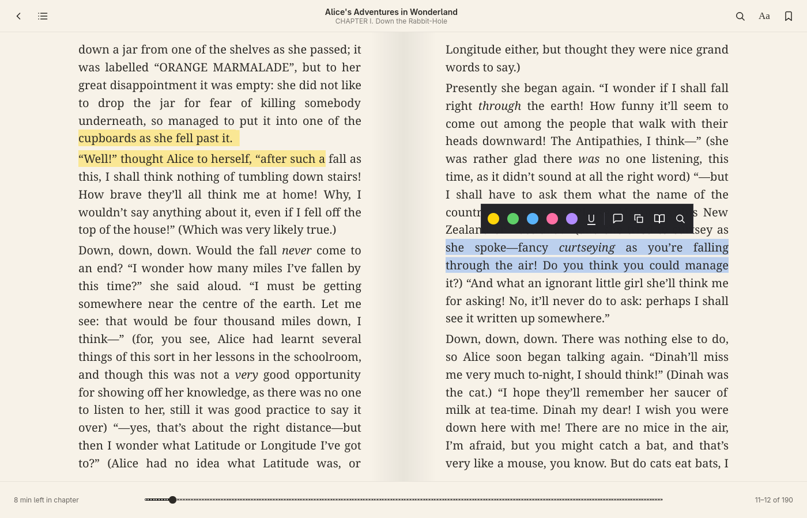
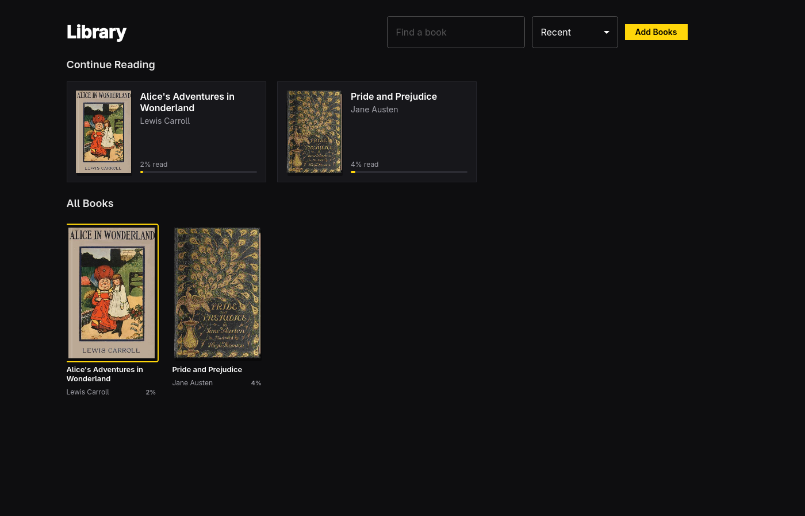

# Nell



Nell reads EPUB and PDF books on Omarchy. It looks and moves like Apple Books
— a shelf of covers, full-bleed pages in a reading theme, controls that stay
out of the way — and keeps the best of Kindle: time left in the chapter learned
from your own pace, a dictionary on any word with a Words list of everything you
looked up, and your highlights and notes exportable as Markdown.



- **Library.** A sidebar, once the window is 900 px wide, names the places:
  All Books, Reading, Finished, each catalog, and the reading record; narrower
  than that the same things sit in the library's header. Left off the shelf's
  first column reaches it; Right or Esc comes back. Add books with the
  file chooser, by dropping them on the window,
  or by opening one from a file manager. Books stay where they are and are never
  modified; a book's identity is its contents, so a moved file keeps its notes.
- **Reading.** Pages are paginated to the window, two side by side when there's
  room. Themes (Original, Paper, Calm, Quiet, Night, and Omarchy, which follows
  your desktop theme), typeface, size, line spacing, margins, and justification.
  Original keeps an EPUB's own colors; the other themes use theirs.
  Dark themes show PDFs inverted.
- **Small print.** A PDF whose text would be tiny in the window switches to fit
  text: the page is zoomed until its body text matches your text size, then
  read one screenful at a time. Running headers and footers are dropped (a
  setting of its own, so they can be kept). Each screen ends above a line
  rather than through it; where there's no clean place to cut, as with
  staggered columns, the line cut at the foot of one screen is shown whole at
  the top of the next, so nothing is skipped. A scanned PDF has no text to
  measure and isn't fitted. `Ctrl++` and `Ctrl+−` change the zoom; Appearance
  turns it off for that book.
- **Marking.** Select text to highlight it in five colors or underline it, add a
  note, copy it, look it up in Wiktionary, or search for it. Bookmark pages.
  Everything undoes.
- **Finding.** Contents, bookmarks, notes, and words in one panel; full-text
  search of the whole book.
- **Footnotes and pictures.** A footnote reference opens its note in a card
  beside it, with a way to the note itself. A picture opens full-window, and
  zooms.
- **Hyphenation.** Words break at the ends of lines as in a printed book, from
  TeX's patterns for English, German, French, Spanish, Dutch, and Danish,
  bundled; a book in another language is set without. Off in Appearance.
- **Reading ruler.** `R` puts a band on the line being read and dims the rest;
  `↓` and `↑` then move it a line at a time, turning the page at the ends.
- **Page peek.** `` ` `` pins the page; look anywhere, press it again to come
  back. Held down, it comes back on release. A chip at the foot of the page
  is the way back with the mouse.
- **A reading record.** The time spent on pages and the pages turned, day by
  day, from which come today's minutes against a daily goal, the streak, the
  week, the year's books and hours, and badges. `S` in the library, or
  `nell stats`. Nothing leaves the machine.
- **Catalogs.** Books from Calibre's content server, Kavita, or any OPDS
  feed: browse, search, and get; a book got lands in the library. Five
  free catalogs come built in — Project Gutenberg, ManyBooks, Unglue.it,
  textos.info (Spanish) and Ebooks libres et gratuits (French) — so there's
  something to read before you add your own. `C` in the library.
- **Knowing where you are.** The bottom-left corner shows one of five things —
  time left in the chapter, time left in the book, pages left in the chapter,
  the Kindle-style location (the page, in a PDF), or the percent read. Click it
  to pick from a menu, or press `P` to cycle; `Ctrl+G` goes to a page or a
  percentage.

Nell follows the Omarchy accent and window rounding live, and the language set
under Setup > Language (Danish, Dutch, English, French, German, and Spanish so
far).

## Shortcuts

Press `?` in the app to see them all.

| Key | In a book |
| --- | --- |
| `→` `Space` `PgDn` | Next page |
| `←` `Shift+Space` `PgUp` | Previous page |
| `]` `[` | Next or previous chapter |
| `Home` `End` | Start or end of the book |
| `Ctrl+G` | Go to a page or percent |
| `P` | Change what the progress corner shows |
| `T` | Contents, bookmarks, notes, and words |
| `/` `Ctrl+F` | Search the book |
| `A` | Appearance |
| `Ctrl++` `Ctrl+−` | Bigger or smaller text |
| `R` | Reading ruler; `↓` `↑` then move it a line |
| `` ` `` | Pin the page and press again to come back; hold to peek |
| `B` | Bookmark the page |
| `H` / `N` / `D` | Highlight (in the last color used), note, or look up the selection |
| `Tab` | Show the controls and move through them |
| `Ctrl+C` | Copy the selection |
| `Ctrl+Z` `Ctrl+Shift+Z` | Undo or redo |
| `Esc` | Close a panel, or back to the library |

| Key | In the library |
| --- | --- |
| `Space` `Enter` | Open the selected book |
| `Ctrl+O` | Add books |
| `/` `Ctrl+F` | Find a book |
| `S` | Reading goal, streak, and badges |
| `C` | Catalogs |
| `Delete` | Remove the selected book from the library |
| `F11` `F` | Full screen |
| `Ctrl+Q` `Q` | Quit |

Letter keys act on the page or the shelf only; while you type in a field they
type, and while a panel is open the page stays put.

## Command line

Every command takes `--json`, exits 0 or 1, and needs no display, so agents and
scripts can use the library too. `nell skill install` installs a short skill
that tells coding agents how.

```sh
nell open [book]          # the reader, or a book in it
nell list                 # the library, most recently read first
nell add <file>...        # add EPUB and PDF books
nell info <book>          # title, author, and contents
nell notes <book>         # highlights and notes as Markdown (--json for data)
nell stats                # today's reading, the streak, the week, the badges
```

## Where things are kept

- `~/.local/share/nell/library.json` — the library.
- `~/.local/share/nell/books/<id>.json` — each book's place, bookmarks,
  highlights, notes, and looked-up words. Removing a book from the library
  keeps this, so adding it again brings them back.
- `~/.local/share/nell/reading.json` — the reading record: seconds and
  characters read, per day and per book.
- `~/.local/share/nell/catalogs.json` — the catalogs and their logins,
  readable by you alone. Until the list is first changed there is no file,
  and the built-in catalogs are the list.
- `~/Documents/Books/` — where books got from a catalog are saved (a setting
  on the Catalogs page).
- `~/.cache/nell/` — unpacked EPUBs, covers, and catalog thumbnails; safe to
  delete.
- `~/.config/nell/nell.conf` — appearance settings, the daily goal, and your
  learned reading speed.

Every JSON file carries a `version` field for its format.

Looking up a word sends that word, and nothing else, to Wiktionary. A catalog
is only spoken to while you browse it. The reading record stays on the machine.

## Building

Nell is C++ and Qt Quick, built with qmake into one binary. It uses Poppler for
PDFs and `bsdtar` (libarchive) to unpack EPUBs.

```sh
bin/build     # build/nell
bin/test      # the Qt Test suite, offscreen
bin/install   # build and install the Arch package, so it's in the app launcher
```

## Documentation

- [Architecture](docs/architecture.md): how the pieces fit, and how a place in a book is stored
- [File formats](docs/file-formats.md): the library and annotation JSON, and the settings
- [Releasing](docs/releasing.md): versioning and cutting a release

## Install

On Arch or Omarchy, from a clone:

```sh
git clone https://github.com/jvandenbos/nell.git
cd nell
bin/install   # builds, then makepkg -si (asks for sudo)
```

Depends on `qt6-base`, `qt6-declarative`, `qt6-svg`, `qt6-wayland`,
`poppler-qt6`, `libarchive`, and `xdg-desktop-portal`.

## License

MIT. The theme watcher, translator, and portal file chooser come from Omacut,
Monologue, and Hype by David Heinemeier Hansson.
