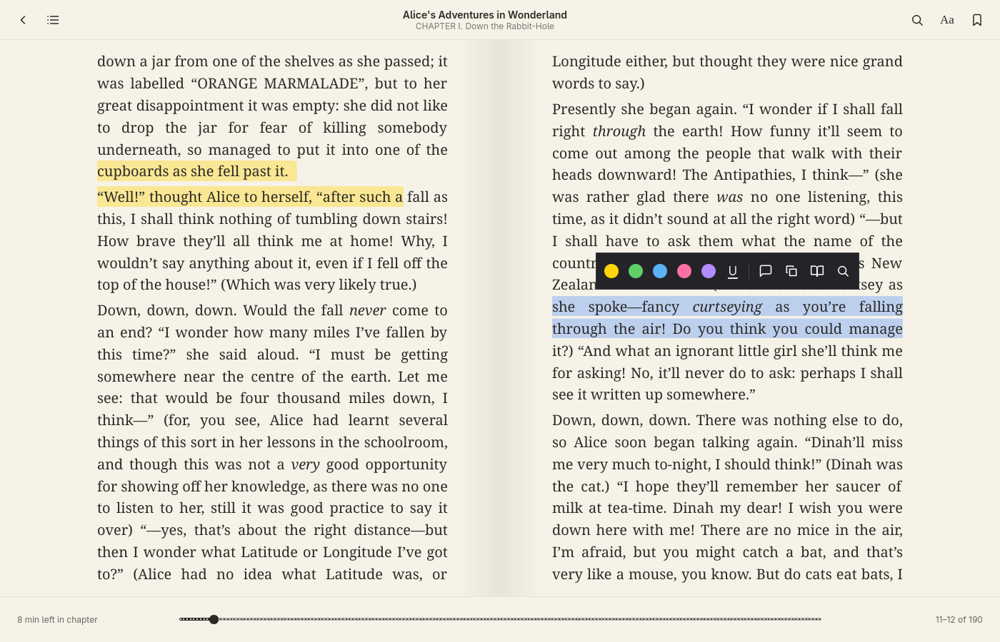
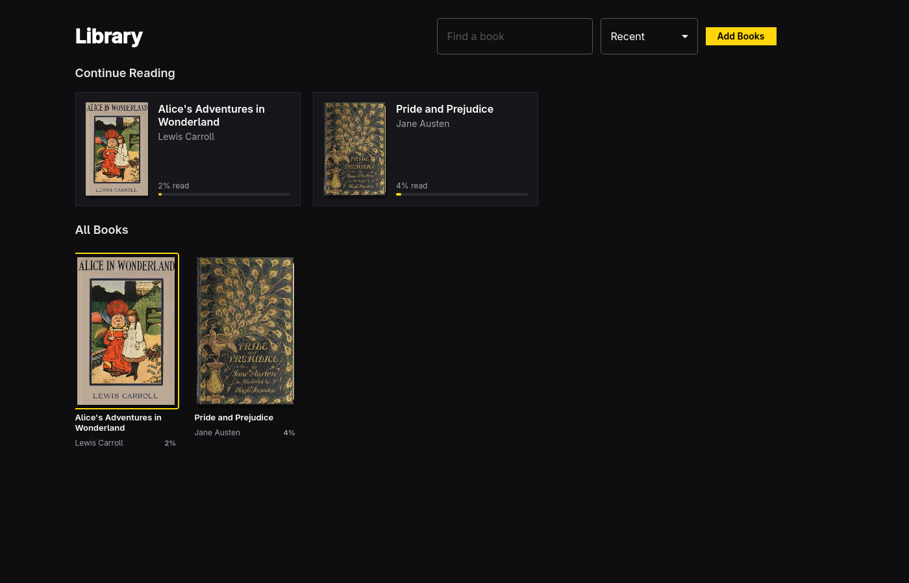

# Nell



Nell reads EPUB and PDF books on Omarchy. It looks and moves like Apple Books
— a shelf of covers, full-bleed pages in a reading theme, controls that stay
out of the way — and keeps the best of Kindle: time left in the chapter learned
from your own pace, a dictionary on any word with a Words list of everything you
looked up, and your highlights and notes exportable as Markdown.



- **Library.** Add books with the file chooser, by dropping them on the window,
  or by opening one from a file manager. Books stay where they are and are never
  modified; a book's identity is its contents, so a moved file keeps its notes.
- **Reading.** Pages are paginated to the window, two side by side when there's
  room. Themes (Original, Paper, Calm, Quiet, Night, and Omarchy, which follows
  your desktop theme), typeface, size, line spacing, margins, and justification.
  Dark themes show PDFs inverted.
- **Small print.** A PDF whose text would be tiny in the window switches to fit
  text: the page is zoomed until its body text matches your text size, then
  read one screenful at a time. Running headers and footers are dropped, and
  no line is ever cut in half. `Ctrl++` and `Ctrl+−` change the zoom; Appearance
  turns it off for that book.
- **Marking.** Select text to highlight it in five colors or underline it, add a
  note, copy it, look it up in Wiktionary, or search for it. Bookmark pages.
  Everything undoes.
- **Finding.** Contents, bookmarks, notes, and words in one panel; full-text
  search of the whole book.
- **Knowing where you are.** Click the bottom-left corner to cycle between time
  left in the chapter, time left in the book, pages left in the chapter, and
  Kindle-style locations.

Nell follows the Omarchy accent and window rounding live, and the language set
under Setup > Language (Danish, Dutch, English, French, German, and Spanish so
far).

## Shortcuts

Press `?` in the app to see them all.

| Key | In a book |
| --- | --- |
| `→` `Space` `PgDn` | Next page |
| `←` `Shift+Space` `PgUp` | Previous page |
| `]` `[` | Next or previous chapter |
| `Home` `End` | Start or end of the book |
| `T` | Contents, bookmarks, notes, and words |
| `/` `Ctrl+F` | Search the book |
| `A` | Appearance |
| `Ctrl++` `Ctrl+−` | Bigger or smaller text |
| `B` | Bookmark the page |
| `H` / `N` / `D` | Highlight, note, or look up the selection |
| `Ctrl+C` | Copy the selection |
| `Ctrl+Z` `Ctrl+Shift+Z` | Undo or redo |
| `Esc` | Close a panel, or back to the library |

| Key | In the library |
| --- | --- |
| `Space` `Enter` | Open the selected book |
| `Ctrl+O` | Add books |
| `/` `Ctrl+F` | Find a book |
| `Delete` | Remove the selected book from the library |
| `F11` `F` | Full screen |
| `Q` | Quit |

## Command line

Every command takes `--json`, exits 0 or 1, and needs no display, so agents and
scripts can use the library too. `nell skill install` installs a short skill
that tells coding agents how.

```sh
nell open [book]          # the reader, or a book in it
nell list                 # the library, most recently read first
nell add <file>...        # add EPUB and PDF books
nell info <book>          # title, author, and contents
nell notes <book>         # highlights and notes as Markdown (--json for data)
```

## Where things are kept

- `~/.local/share/nell/library.json` — the library.
- `~/.local/share/nell/books/<id>.json` — each book's place, bookmarks,
  highlights, notes, and looked-up words. Removing a book from the library
  keeps this, so adding it again brings them back.
- `~/.cache/nell/` — unpacked EPUBs and covers; safe to delete.
- `~/.config/nell/nell.conf` — appearance settings and your learned reading speed.

Both JSON files carry a `version` field for their format.

Looking up a word sends that word, and nothing else, to Wiktionary.

## Building

Nell is C++ and Qt Quick, built with qmake into one binary. It uses Poppler for
PDFs and `bsdtar` (libarchive) to unpack EPUBs.

```sh
bin/build     # build/nell
bin/test      # the Qt Test suite, offscreen
bin/install   # build and install the Arch package, so it's in the app launcher
```

## Documentation

- [Architecture](docs/architecture.md): how the pieces fit, and how a place in a book is stored
- [File formats](docs/file-formats.md): the library and annotation JSON, and the settings
- [Releasing](docs/releasing.md): versioning and cutting a release

## Install

On Arch or Omarchy, from a clone:

```sh
git clone https://github.com/jvandenbos/nell.git
cd nell
bin/install   # builds, then makepkg -si (asks for sudo)
```

Depends on `qt6-base`, `qt6-declarative`, `qt6-svg`, `qt6-wayland`,
`poppler-qt6`, `libarchive`, and `xdg-desktop-portal`.

## License

MIT. The theme watcher, translator, and portal file chooser come from Omacut,
Monologue, and Hype by David Heinemeier Hansson.
